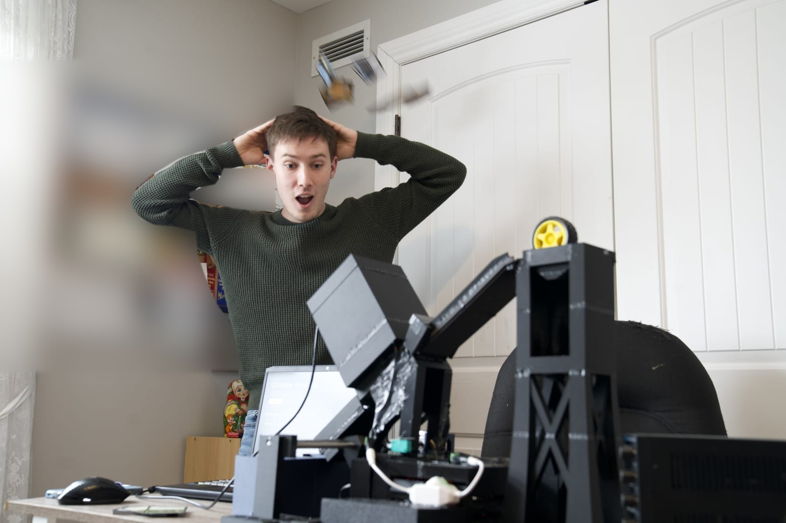
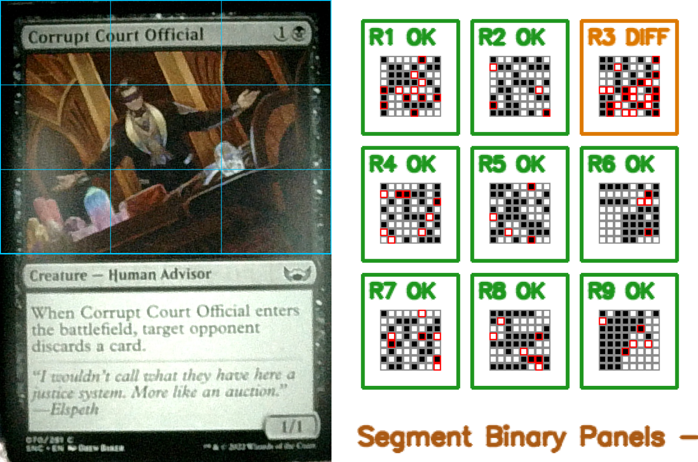

# P.H.A.S.E.

**P**erceptual **H**ashing for an **A**utomated **S**orting **E**ngine: a mechatronic Magic: The Gathering card sorter that feeds cards one at a time under a camera, identifies each one, looks up its price, and drops it into one of three bins.



*The machine mid-run. (Papers on the wall behind are blurred for privacy.)*



*A card as the camera sees it, split into the 3x3 grid used for matching. Each panel on the right is one cell's 64-bit hash; red squares are bits that differ from the database copy.*

## What it does

You load a stack of cards. The machine feeds them through one by one and, for each card:

1. takes a photo,
2. works out which card it is (name and set, out of ~100,000 printings),
3. gets its current price from Scryfall, and
4. sorts it into **high value**, **low value** (CAD $0.98 or less) or **unidentified**.

Every run is logged to an Excel workbook (name, price, image path, timing). You can load up to 450 cards at a time and come back in about an hour.

## Why I built it

I have a collection of more than 13,000 Magic cards, built up over about ten years, and there are over 110,000 unique printings. Sorting a collection like that by hand takes weeks. Commercial card sorters exist, but they cost tens of thousands of dollars and charge monthly software fees, which puts them out of reach for an individual collector. The hypothesis was that a home-built machine could get close to their sorting speed and accuracy for a small fraction of the cost.

## Results

These are my own measurements from running the finished machine, not an independent benchmark:

| | P.H.A.S.E. |
|---|---|
| Build cost | CAD $410.39 |
| Sorting speed | 300-375 cards/hour |
| Identification accuracy | 100% in my testing |
| Capacity | 450 cards per load |

For comparison, the commercial machines I found cost roughly CAD $3,800 to $44,000 up front plus CAD $37 to $340 a month for software, and sort 300 to 3,000 cards/hour. So the faster ones (up to 3,000/hour) are well ahead of P.H.A.S.E. on speed; the point of this project is the cost. The full comparison is on the [project page](https://ark-stem.com/projects/8181e7dd-df1d-4867-8a4c-5f822db34515).

**Limitations.** Printings from different sets are told apart (the matcher zooms in on the usual set-symbol position), but different languages of the same card are not. I haven't published the test set behind the accuracy number, so treat it as a result on my own collection.

## How it works

**Mechanism.** An Arduino runs the hardware (`firmware/FinalSketch.ino`): two stepper motors (DRV8825 drivers), a DC gear motor (L298N driver), MG90S servos and a limit switch. The Python program sends it plain-text serial commands such as `SPIN_CW:M1:<steps>`. One mechanism releases a card into the imaging area; another moves over the storage boxes (about 2050 steps between boxes) and drops the card in.

**Finding the card.** A YOLOv8 oriented-bounding-box model (`models/best.pt`, trained on my own photos of cards in the machine) locates the card in the camera frame. The code then refines the edges and axis, rotates and crops the card to a flat, normalised image.

**Identifying the card.** Matching is by perceptual hashing, in two stages:

1. *Shortlist.* A 64-bit pHash of the whole card is looked up in an [Annoy](https://github.com/spotify/annoy) nearest-neighbour index of every card in Scryfall, keeping up to 1,000 candidates.
2. *Re-rank.* The top 55% of the card is split into a 3x3 grid; each cell has its own pHash and dHash. Candidates are scored by how many cells match within a Hamming-distance threshold, with the centre (artwork) cells weighted most. Both card orientations are tried. The result is "confident", "possible" (with a ranked list of alternatives) or no match.

This uses the card's artwork and layout rather than OCR, so it copes with the blur, glare and small rotations of a cheap camera. See `mtg_hash_v2/` for the matcher and `docs/hash_visualizations/` for what the hashes look like.

**Control flow** (`Expo_P.H.A.S.E.py`, `continuous_release_identify_and_sort`):

```
connect to Arduino -> open camera -> load hash DB + Annoy index + YOLO model
loop:
    release a card into the imaging area
    capture -> locate (YOLO) -> hash -> match -> fetch price
    release the card and start routing it (high / low / unidentified)
    move the carriage over the right box, drop, return home
    log to Excel, update the live display
```

Routing runs on its own thread, so the next card can be imaged while the previous one is still being put away. `--dry-run` skips the Arduino for testing the vision side.

## Tech stack

- Python 3.11: OpenCV, NumPy, Pillow, imagehash, Annoy, Ultralytics YOLOv8 (PyTorch), pyserial, openpyxl, requests
- Flask + vanilla JS for the live display used at the expo (`gen_expo_visualization_files/`)
- Arduino C++ for motor control (`firmware/`)
- [Scryfall](https://scryfall.com/docs/api) API and bulk data for card data, images and prices

## Super Expo-sciences

P.H.A.S.E. was presented at the provincial Super Expo-sciences. `gen_expo_visualization_files/` is the display that ran next to the machine: it shows the latest card, the camera hashes compared to the database hashes, and the localisation steps, so visitors could see why a card matched.

## Hardware setup

**This was built for one specific physical machine and has not been tested on any other.** I can't promise it will run as-is elsewhere. What it expects:

- Windows (the main script uses `msvcrt` and DirectShow camera access)
- An Arduino on a serial port (COM8 on my machine) running `firmware/FinalSketch.ino`, wired as described in the comments at the top of that file: stepper DIR/STEP on pins 5/4 and 7/6, TT motor on pins 10/9/8, servos, and a limit switch
- A USB camera pointed at the imaging area, with the lighting roughly like mine
- Storage boxes at fixed distances along the second stepper's travel

**How it was built.** The body is about 60 unique 3D-printed parts (PLA and PETG), modelled in Blender, printed on a Prusa MINI+ over several months and plastic-welded together. The whole project took over 550 hours across about a year; it was my first electronics project. The code is around 13,000 lines, mostly Python, plus C++ (Arduino), HTML and JavaScript.

**Main parts:** Arduino Uno; 2x NEMA 17 stepper motors with 2x DRV8825 drivers; 2x MG90S servos; a TT gear motor with an L298N driver; a contact sensor (limit switch); a 12 MP USB camera; a 12 V LED strip for lighting; 3x LM2596 buck converters and a bench power supply; aluminium rod, ball bearings and UHMW tape for the mechanics. The full shopping list is on the project page.

The ports and camera index live in [`phase_config.py`](phase_config.py); change those first. Motor step counts, servo angles and timings are constants near the top of `Expo_P.H.A.S.E.py` and were tuned by hand for my mechanics.

## Running it

```bash
pip install -r requirements.txt        # versions are approximate
```

1. Download the database files from the [Releases](../../releases) page into the repo root (see [docs/DATABASE.md](docs/DATABASE.md); this also explains how to rebuild them from Scryfall).
2. Edit `phase_config.py`, then:

```bash
python Expo_P.H.A.S.E.py            # full run with hardware
python Expo_P.H.A.S.E.py --dry-run  # no Arduino
```

Run from the repo root: paths to the databases and model are relative.

## Repo layout

```
Expo_P.H.A.S.E.py       main program (vision, matching, motor control, sorting loop)
phase_config.py         serial port, baud rate, camera index
YOLO_Camera_Studio.py   camera setup + YOLO locator helpers
CamTesting.py           camera/locator test tool and shared helpers
mtg_hash_v2/            segmented-hash matcher
build_*.py, update_*.py DB build/update scripts (see docs/DATABASE.md)
firmware/               Arduino sketches (FinalSketch.ino is the current one)
models/                 trained card-locator weights
gen_expo_visualization_files/   Flask display used at the expo
hardware_tests/         small standalone motor and camera tests
training/               YOLO dataset configs
docs/                   database notes, hash visualisations
archive/                older versions and experiments, kept for reference
```

## Status and credits

Started in 2024 and built over about a year at Champlain College Lennoxville (CEGEP), as my 4th-semester Integrative Project. It's a student project: the main script grew organically, and some old experiments are kept in `archive/` rather than cleaned up. I'm now studying engineering at the University of Toronto, and this project is what got me into it.

Project write-up and build details: [P.H.A.S.E. on Ark](https://ark-stem.com/projects/8181e7dd-df1d-4867-8a4c-5f822db34515).

Card data and prices come from [Scryfall](https://scryfall.com). Magic: The Gathering is a trademark of Wizards of the Coast; this project is not affiliated with or endorsed by them or Scryfall.

Licensed under the MIT License.
